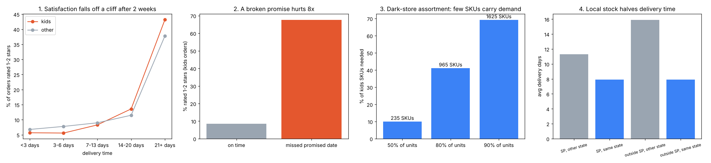
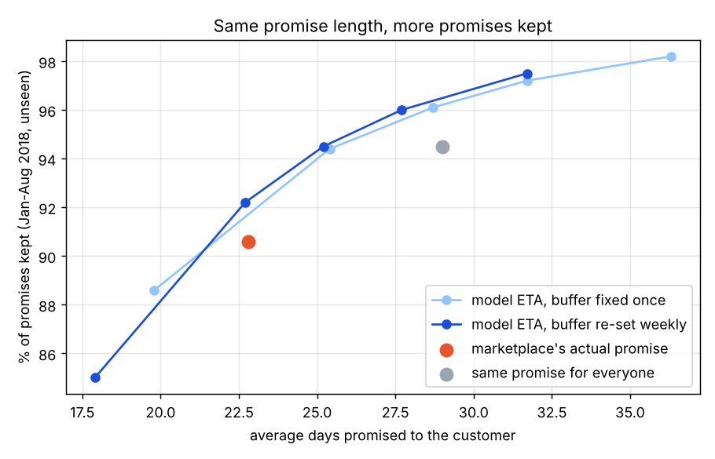

# Kids Commerce Analytics: What Makes Parents Happy, Late, or Loyal

[](https://github.com/f20220970-debug/ozi-kids-qcommerce-analytics/actions/workflows/tests.yml)

**[Live demo](https://f20220970-debug.github.io/ozi-kids-qcommerce-analytics/)**: Try the late-delivery and dark-store sliders.

## In 30 seconds
- At the same delivery time, a missed promise lifts 1-2 star reviews from 9% to 25%.
- A delivery-time model breaks 17% fewer promises at the same promise length, on 52,768 later orders.
- 10% of kids products carry 50% of units, but only 11 of the top 50 stay top 50 six months later.


Built exclusively for **OZi's PS-II Product Intern / Product Analyst Intern application**. OZi delivers baby and
kids essentials fast in Gurugram. This project asks the questions a product analyst there would own, and
answers them in **SQL (DuckDB)** and **Excel** on real order data:

1. Does delivery speed matter to parents, and where does it stop mattering?
2. Is it slowness or a broken promise that causes bad reviews?
3. How many SKUs does a dark store need to carry?
4. How much does stocking locally help?
5. Do kids shoppers come back, and what do they buy when they do?

> **Real data, used as a proxy.** OZi's data is private, so this uses the Olist public e-commerce dataset:
> about 99K real orders from a Brazilian marketplace (2016–2018), of which **6,787 contain kids items**
> (baby, toys, diapers and hygiene, children's clothes). Delivery here takes days, not minutes, so the
> exact numbers won't carry over. The questions, the SQL and the way of reading the results do.



## Findings
| # | Question | Answer (kids orders unless stated) | What I'd do at OZi |
| --- | --- | --- | --- |
| 1 | Does speed matter? | Under 7 days, satisfaction is flat (4.5 average, about 6% rated 1–2 stars). At 14–20 days, 1–2 star reviews double to 14%. At 21+ days they reach **43%**. | Speed matters up to a threshold, then stops adding much. Find OZi's threshold (it may be 30 vs 60 minutes) before spending on "faster". |
| 2 | Slow or broken promise? (see A below) | Orders that **missed the promised date: 68% rated 1–2 stars**, vs 8.5% on time. The marketplace promised 23 days and delivered in 12 on average, yet the 7% that missed still did most of the damage. | Show an ETA you can keep. Track **promise-kept rate** as a top metric, not just average delivery time. |
| 3 | What do angry parents write? | 41% of 1–2 star kids reviews mention delay or non-delivery; defect or quality comes up in 12.0% vs 9.9% for other orders. | Quality checks matter more for kids items (toys and baby products are judged on safety). |
| 4 | How many SKUs? | **10% of kids SKUs (235) give 50% of units; 41% (965) give 80%**; the last 10% of units needs 700 more SKUs. | Stock the head in the dark store; serve the long tail later or drop it. Revisit the list weekly. |
| 5 | Does local stock help? | For customers outside São Paulo, a seller in the same state delivers in **7.9 days vs 15.9**, late **3.4% vs 8.8%**, rating 4.41 vs 4.07. | The case for dark stores in one city: depth before breadth. |
| 6 | Where is demand? | São Paulo alone is 15.7% of kids orders and is the fastest (7.7 days, 4.8% late); Rio is 7.3% but twice as slow (14.4 days, 13.1% late). | Density makes speed cheap. Win Gurugram sector by sector before a new city. |
| 7 | Do they come back? | Repeat purchase within 180 days is only **1.9%** (marketplace effect, and the same as other shoppers). But **when kids shoppers do return, 47% buy kids items again**, vs 5% of other shoppers. | Repeat is OZi's core metric. Replenishment nudges (diapers, wipes, formula) aimed at a category parents already trust. |

Basket size is similar to the rest of the store (average R$133 vs R$137, and 94% are single-item),
so a kids store has to win on frequency, not basket size.

## A mistake I caught
My first repeat-rate query returned **72%**. That's impossible for a marketplace. The cause:
customers with no second order had a NULL comparison, and `AVG` silently skipped them, so the "rate" was
computed only over people who came back. Wrapping the comparison in `COALESCE(..., false)` gave the real
1.9%. A test now fails if the repeat rate is ever above 10% (`tests/test_sql.py`).

## Going deeper (models, not just queries)

### A. Is it the broken promise, or just slowness? (`src/late_effect.py`)
Finding 2 compared late orders (34 days) with on-time ones (10 days), which mixes slowness and the broken
promise. So I compared orders that **took the same time**:

| Delivery took | On time: % rated 1–2 stars | Late: % rated 1–2 stars | Gap |
| --- | --- | --- | --- |
| 0–7 days | 7.4 | 8.0 | +0.6 pp |
| 7–14 days | 8.8 | **25.3** | **+16.5 pp** |
| 14–21 days | 10.7 | 30.8 | +20.0 pp |
| 21–28 days | 14.2 | 42.6 | +28.4 pp |

Same 7–14 day wait: if it was promised, 9% are angry; if it broke the promise, 25% are.
A logistic regression on 95,306 orders, controlling for delivery time (spline), distance, freight, price, items,
sellers, state and category, gives **odds ratio 3.87** for being late, and an average effect of **+18.2 pp**
on the 1–2 star share (bootstrap 95% CI 16.6–19.5). Arriving very early adds little: on-time orders with
7–21 days to spare score 4.31–4.34 vs 4.13 when they arrive in the last 3 days.
**So for OZi: an honest ETA matters more than a heroic one.** That's the reason for model B.

### B. An ETA model that keeps more promises (`src/eta_model.py`)
Gradient-boosted **quantile regression** predicts delivery time from what's known at checkout
(seller-to-customer distance from 1M geolocation rows, states, weight, volume, freight, the seller's past
handling time). The shown ETA = a high quantile + a buffer that is **re-calibrated every week** on orders
from 4–8 weeks earlier (conformal-style), so it adapts when the network slows down.
Trained on 2016–Oct 2017, tested on **52,768 future orders (Jan–Aug 2018)**.



| | Avg days promised | Promises kept | Missed |
| --- | --- | --- | --- |
| Marketplace's own promise | 22.8 | 90.6% | 9.4% |
| **Model, p80 + weekly buffer** | **22.7** | **92.2%** | **7.8%** |

- **Same promise length** (difference −0.1 days, 95% CI −1.8 to 1.4) with **1.6 pp more promises kept**
  (CI 0.6–2.5, week-block bootstrap), i.e. **17% fewer broken promises**. Biggest win in March 2018, when
  deliveries slowed: the marketplace kept 78.6%, the model 84.1%.
- Point accuracy: median error **4.9 days** vs 5.3 for "median of this seller-state → customer-state route"
  and 6.3 for one global median. Most useful inputs: same-state seller, seller's past handling time,
  distance, customer state.
- **A leak I caught:** the first version used each seller's average handling time over the whole training
  period, which includes the order being predicted. In-sample error was 3.6 days but on future orders 8.1.
  Using only the seller's *previous* orders fixed it (test: `test_seller_history_uses_only_past_orders`).
- With the model's 93% target, it keeps 94.4% of promises at 25.2 days. The curve lets the business choose the
  trade-off rather than guess it.

### C. Dark-store stocking for kids SKUs (`src/stock_sim.py`, `sql/11_bestseller_churn.sql`)
- **Bestsellers don't last.** Of the top 50 kids SKUs in Jul–Dec 2017, only **11 were still top 50** in
  Jan–Jun 2018 and **14 sold nothing**; they made up just 13% of the next half's units. A dark-store list
  has to be refreshed continuously, not set once.
- **SKU-level weekly demand is very sparse** here (73% of SKU-weeks sell zero). Every forecast I tried
  had error above 100% WAPE (4-week average best at 110%; Croston, built for intermittent demand, was worse
  because these products were fading). So the decision that matters is the **stock buffer**, not the point
  forecast.
- Replaying 2018 for the top 40 SKUs (assumed 30% margin, holding cost 5% of price per week):

| Stocking policy | Fill rate | Weeks out of stock | Profit index |
| --- | --- | --- | --- |
| Stock = forecast | 62.6% | 11.0% | 13,905 |
| **80% service level** | 67.9% | 9.7% | **14,868** |
| Newsvendor optimum (86%) | 72.3% | 8.5% | 14,372 |
| 97% service level | 88.0% | 3.8% | 10,447 |

  Chasing a 97% fill rate costs about 30% of profit on slow movers. With OZi's real data I'd set the
  service level per SKU: high for diapers and formula (a stock-out loses the customer), lower for toys.

## Excel workbook (`ozi_kids_kpi_workbook.xlsx`, 4,866 live formulas, 0 errors)
- **Promise what-if:** change the target late rate (yellow cell) and see the bad-review share move. Cutting
  late deliveries from 6.9% to 3% cuts 1–2 star reviews by about 18% (if the effect is causal; see experiment 1).
- **SKU coverage:** all 2,347 kids SKUs with cumulative-share formulas; type a target (e.g. 80%) and
  `INDEX`/`MATCH` returns how many SKUs you need.
- **Weekly KPIs:** orders, AOV, late %, rating, repeat share, with week-on-week change and a 4-week average.

## Metric dictionary (what I'd put on OZi's weekly dashboard)
| Metric | Definition | Why |
| --- | --- | --- |
| Promise-kept rate | orders delivered by the ETA shown at checkout ÷ delivered orders | Finding 2: the broken promise drives bad reviews |
| Delivery time p50 / p90 | minutes from order to doorstep | p90 shows the bad tail parents remember |
| Fill rate | items delivered ÷ items ordered | Missing items are 13% of bad reviews here |
| 30-day repeat rate | customers ordering again within 30 days of their first order | Core of quick-commerce economics |
| Replenishment conversion | repeat orders containing a repeat SKU (diapers, wipes) | Tests the "habit" thesis |
| SKU coverage | share of demand served by SKUs in the dark store | Finding 4 |

## Experiments I'd propose
1. **Honest ETA vs optimistic ETA.** Unit: user. Arms: the current ETA vs ETA + buffer to hit 95% on time.
   Primary: 1–2 star rate and 30-day repeat. Guardrail: conversion at checkout (a longer ETA may lose some orders).
2. **Replenishment reminder.** Users who bought diapers get a reminder at their own usual reorder interval.
   Primary: 30-day repeat. Guardrail: unsubscribe rate.

## Run it
```bash
pip install -r requirements.txt
python src/get_data.py           # downloads the data from Olist's official GitHub repo (~60 MB)
python src/run.py                # runs sql/01..10 -> results/*.csv
python src/plot.py               # -> docs/results.png
cd src && python build_workbook.py   # -> ozi_kids_kpi_workbook.xlsx
python src/late_effect.py        # ~3 min: late vs on-time at equal delivery time, logistic regression
python src/eta_model.py          # ~15 s: quantile ETA model, trade-off curve
python src/stock_sim.py          # dark-store stocking replay
pytest -q                        # 6 tests (SQL sanity, repeat-rate bug guard, no-leakage check)
```

## Limitations
- Brazil, 2016–2018, marketplace delivery in days. OZi is India, now, and minutes.
- "Kids" is defined by Olist's categories; diapers are only 39 items here, so the replenishment idea
  can't be tested on this data.
- Late vs on-time is still observational, even with controls (A). Experiment 1 is how to know whether
  fixing promises causes better ratings.
- The ETA model was tested on one marketplace's history; for minutes-level quick commerce the same method
  applies with rider and store-prep features instead of seller and state.

Built by Pavitra Seth (BITS Pilani) as preparation for OZi's PS-II. Not affiliated with OZi.
